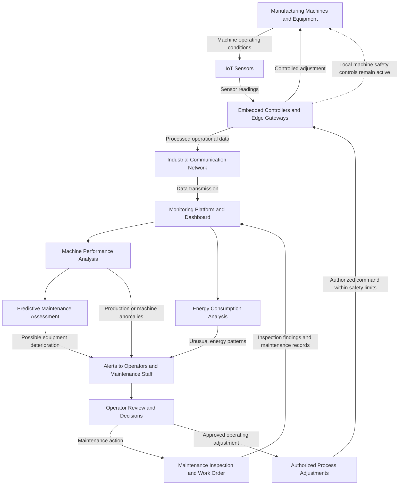
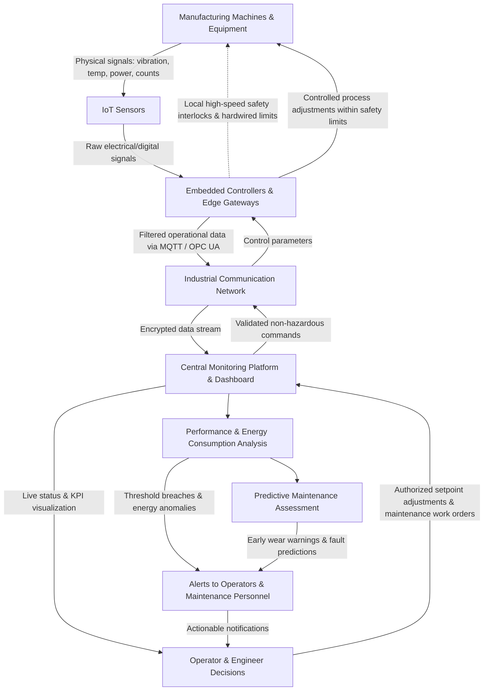
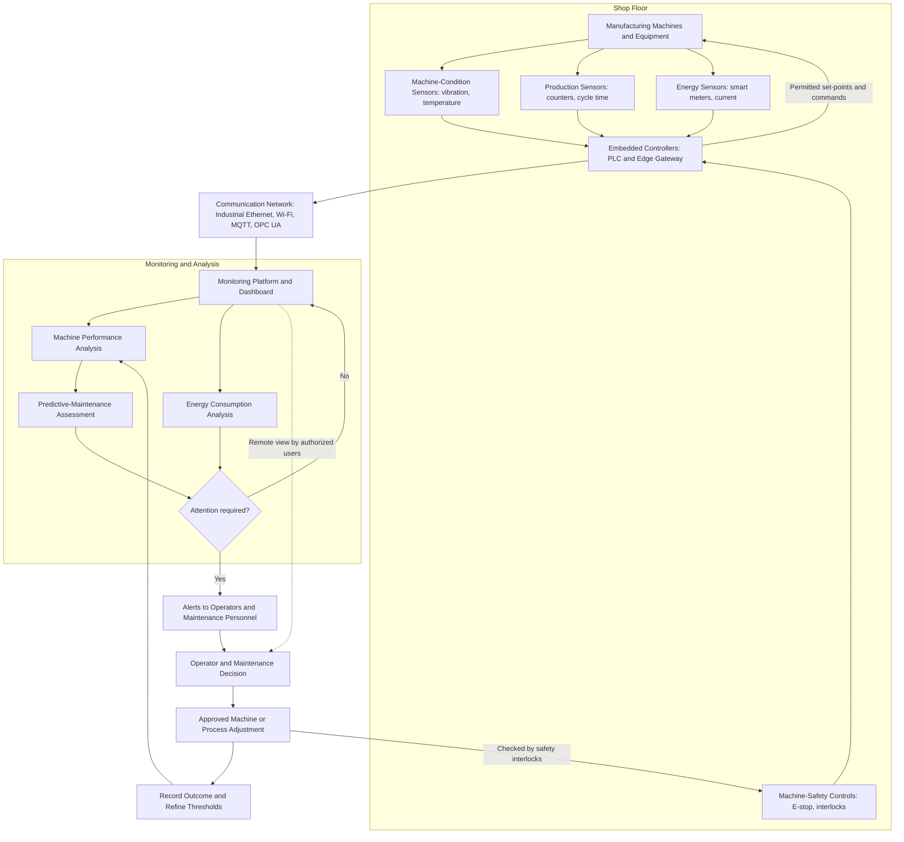

# Ex.No.4-EXP 4 Generate the Prompt and evaluate that for following prompt patterns - Zero-shot Prompting - Few-shot Prompting - Chain of Thought - Persona Pattern - Reverse Prompting - Graph Prompting - Active Prompting
### DATE:
### REGISTER NUMBER :

### Aim:
To write the prompt for the following prompt types and compare that with different AI tools and evaluate that using any one evaluation method (Rubrics): Zero-shot Prompting, Few-shot Prompting, Chain of Thought, Persona Pattern, Reverse Prompting, Graph Prompting, Active Prompting.

### Explanation:
One use case from Unit 5, **IoT-Based Smart Manufacturing Automation**, is used, and a prompt is written for it with each of the seven prompt types from Unit 2. The same prompts, with identical wording, were run on each AI tool and the responses are recorded below.

> **Tools compared:** ChatGPT, Google Gemini, and Claude.

---

## Procedure

### 1. Define the Scenario and Use Case

**Scenario:**
The manufacturing industry is looking to reduce manual monitoring and increase efficiency through automation. The system will utilize IoT devices and embedded controllers to automate equipment, monitor machine performance, and enable predictive maintenance. The goal is to streamline the production process, minimize downtime, and enhance energy efficiency.

**Target Audience:**
Manufacturing companies, specifically in sectors like automotive, electronics, and food processing, where automation can significantly improve productivity.

**Main Objectives:**
- Improve production efficiency by 30%.
- Minimize machinery downtime with predictive maintenance.
- Enable real-time monitoring and remote control of manufacturing systems.
- Reduce energy consumption by optimizing processes.

### 2. Identify Prompt Patterns for the Use Case

| No. | Prompt pattern | Definition |
|---:|---|---|
| 1 | Zero-Shot Prompting | The model is given a direct task with clear instructions but no examples. It relies entirely on its prior knowledge. |
| 2 | Few-Shot Prompting | The prompt includes a small number of input-output examples so the model can imitate the demonstrated style and format. |
| 3 | Chain-of-Thought Prompting | The prompt asks the model to work through a problem in ordered stages, so the reasoning and conclusions at each step are visible. |
| 4 | Persona Pattern | The model is assigned a role (here, an experienced Industrial IoT Engineer) so that the tone, depth, and viewpoint match that expertise and audience. |
| 5 | Reverse Prompting | Instead of asking for the final output, the model is asked to write the reusable prompt that would generate it. |
| 6 | Graph Prompting | The model is asked to express the answer as a structured diagram (here, a Mermaid flowchart) showing elements and their relationships. |
| 7 | Active Prompting | The model is told to ask clarifying questions, one at a time, and gather missing information before producing a customized answer. |

---

## 3. Prompts Used and Responses Received

### 3.1 Zero-Shot Prompting

#### Prompt

```text
You are helping a manufacturing company implement IoT-based smart manufacturing automation. Explain how IoT sensors and embedded controllers can improve production efficiency, reduce machinery downtime, enable real-time monitoring and remote control, and reduce energy consumption. Present the solution in simple language with practical manufacturing examples. Organize your response under the headings: Overview, System Components, How the System Works, Benefits, and Implementation Considerations. The company's target is to improve production efficiency by 30%; explain how progress toward this target could be measured without assuming that the target is guaranteed.
```

#### Response: ChatGPT

**Overview**

IoT-based smart manufacturing connects machines, sensors, controllers,
and monitoring software so that a factory can observe and manage its
operations using real-time data. Instead of depending entirely on
workers to inspect machines and record production information manually,
the system collects operating data automatically.

For example, in an automotive factory, sensors can monitor the vibration
and temperature of motors used on an assembly line. In an electronics
factory, sensors can count circuit boards passing through a production
station. This information helps supervisors identify delays, unusual
machine behaviour, and opportunities to reduce energy use.

**System Components**

| Component | Purpose | Example |
|---|---|---|
| IoT sensors | Measure machine and production conditions | Temperature, vibration, current, proximity and photoelectric sensors |
| Embedded controllers | Receive sensor data and control local equipment | Programmable Logic Controllers (PLCs) and industrial controllers |
| Edge gateway | Collect and process data close to the machines | Industrial IoT gateway |
| Communication network | Transfer data between equipment and the monitoring platform | Industrial Ethernet, Wi-Fi or other suitable industrial networks |
| Monitoring platform | Display machine status, production information and alerts | Industrial dashboard or SCADA/IIoT platform |
| Data storage and analytics | Store historical information and identify trends | Time-series database and analytics software |

**How the System Works**

1.  **Data collection:** Sensors installed on machines measure
    parameters such as temperature, vibration, current consumption,
    machine status and product count.
2.  **Local processing:** Embedded controllers collect sensor readings
    and perform the control functions for which they are configured.
    They can identify conditions that require an immediate local
    response.
3.  **Data transmission:** An edge gateway or controller sends relevant
    information through the industrial network to a monitoring platform.
4.  **Visualization:** A dashboard displays machine status, production
    rates, downtime, alerts and energy information.
5.  **Maintenance decisions:** When readings show unusual behaviour, the
    system alerts maintenance personnel so that they can inspect the
    equipment.
6.  **Process improvement:** Supervisors use production and energy
    information to identify bottlenecks, reduce idle operation and plan
    improvements. Any remote adjustments must be authorized and remain
    within machine-safety controls.

**Benefits**

-   **Improved production efficiency:** Automatic data collection
    reduces manual recording and helps supervisors identify bottlenecks,
    repeated stoppages and slow production stages.
-   **Reduced machinery downtime:** Vibration, temperature and current
    trends can reveal possible equipment deterioration. Maintenance can
    then be planned before a fault causes an unexpected stoppage.
-   **Real-time monitoring:** Supervisors can view machine status and
    production information from a central dashboard.
-   **Remote supervision and control:** Authorized personnel may adjust
    approved process settings remotely where the equipment design and
    safety procedures permit it. Safety interlocks and emergency-stop
    functions must remain independent and effective.
-   **Reduced energy consumption:** Energy meters can identify equipment
    that consumes excessive power or remains active when it is not
    required.
-   **Better production decisions:** Historical data helps management
    compare shifts, machines and production periods.

**Implementation Considerations**

1.  **Existing machinery:** Older machines may not provide digital data.
    Additional sensors or suitable interfaces may be needed.
2.  **Sensor selection:** Sensors must match the operating environment,
    measurement range and accuracy requirements.
3.  **Network reliability:** The factory network must provide dependable
    communication and suitable coverage.
4.  **Cybersecurity:** Network segmentation, strong authentication,
    access control, secure remote access and regular updates are
    important.
5.  **Worker training:** Operators and maintenance staff must understand
    dashboards, alerts and the correct response procedures.
6.  **Integration:** The system may need to exchange information with
    existing production, maintenance or inventory software.
7.  **Safety:** Remote monitoring must not bypass machine guards,
    emergency stops, safety interlocks or approved operating procedures.

**Measuring Progress Toward the 30% Efficiency Target**

The 30% improvement should be treated as a project target, not a
guaranteed result. The company should first establish a baseline before
implementation.

-   Record production output, operating time, downtime, defect rates and
    energy consumption for a representative period.
-   Calculate Overall Equipment Effectiveness (OEE), which combines
    availability, performance and quality.
-   Compare the same indicators after the pilot deployment, taking
    production mix and operating conditions into account.
-   Track unplanned downtime, mean time between failures, cycle time,
    rejected products and energy used per unit.
-   Review the results regularly and identify which changes contribute
    to improvement.

A suitable evaluation method is to compare baseline and
post-implementation performance using consistent definitions and
measurement periods. The company can then determine whether it is
progressing toward the 30% target.

#### Response: Google Gemini

**Overview**

Smart manufacturing automation uses connected sensors and small onboard computers (embedded controllers) to give factory managers real-time visibility into their production lines. By continuously tracking machine health, production speed, and energy use, a factory can shift from reacting to breakdowns to preventing them, streamlining operations without relying on constant manual checks.

**System Components**

*   **IoT Sensors:** Devices attached to machinery that measure physical conditions such as temperature, vibration, electrical current, and product counts.
*   **Embedded Controllers:** Local industrial computers (like PLCs or edge gateways) that collect data from sensors, make split-second automated adjustments, and send information to the main network.
*   **Communication Network:** The wired (Ethernet) or wireless (Wi-Fi, LoRaWAN) infrastructure that securely moves data from the factory floor to a central server or cloud.
*   **Monitoring Platform (Dashboard):** Software that displays live factory performance, sends alerts to staff, and stores historical data for analysis.

**How the System Works**

1.  **Data Collection:** Sensors continuously monitor equipment. For example, a vibration sensor on a robotic welding arm in an automotive plant tracks motor smoothness, while an optical sensor counts finished circuit boards in an electronics facility.
2.  **Local Processing:** Embedded controllers read this data. If a machine jams or overheats past a safe limit, the controller can immediately pause the equipment to prevent damage.
3.  **Transmission & Visualization:** The controllers send summarized performance data to the central dashboard, allowing supervisors to view the entire factory floor from a computer or tablet.
4.  **Action & Optimization:** Maintenance teams receive automated alerts when a machine's vibration pattern changes, allowing them to schedule repairs during planned breaks. Meanwhile, managers use remote controls to adjust conveyor speeds or turn off idling equipment during shift changes.

**Benefits**

*   **Improved Production Efficiency:** Eliminates manual data logging, balances line speeds, and reduces minor stops, keeping output steady.
*   **Reduced Machinery Downtime:** Predictive maintenance catches worn bearings or overheating motors days before they fail, preventing unexpected line shutdowns.
*   **Real-Time Monitoring and Remote Control:** Supervisors can check line status and safely adjust non-critical parameters (like oven temperatures in a food processing plant) from anywhere in the facility.
*   **Reduced Energy Consumption:** Smart meters identify energy-hogging machines and automatically power down auxiliary systems (like compressed air or lighting) when lines are idle.

**Implementation Considerations**

*   **Legacy Equipment:** Older machines may lack built-in digital ports and will require external clip-on sensors to gather data.
*   **Cybersecurity:** Connecting factory machines to a network requires strong firewalls and access controls to prevent unauthorized remote interference.
*   **Staff Training:** Operators and maintenance technicians need training to interpret dashboard alerts and trust automated recommendations.
*   **Network Reliability:** Thick concrete walls and heavy machinery can interfere with wireless signals, making industrial-grade networking essential.

**Measuring Progress Toward the 30% Efficiency Target**

Achieving a 30% improvement in production efficiency is an ambitious goal that depends on the factory's starting condition, equipment age, and process bottlenecks. Rather than assuming this target will be met automatically, the company should measure progress systematically using **Overall Equipment Effectiveness (OEE)** and supporting metrics:
1.  **Establish a Baseline:** Measure current output rates, unplanned downtime hours, defect rates, and energy used per unit over 4–6 weeks before installing the IoT system.
2.  **Track Availability:** Measure the reduction in unplanned machine stops and changeover times.
3.  **Track Performance:** Compare actual machine cycle times against their maximum rated speeds to see if bottlenecks are clearing.
4.  **Track Quality:** Monitor reductions in scrap or rework caused by out-of-spec machine conditions (e.g., improper curing temperatures).
5.  **Conduct Phased Reviews:** Evaluate these metrics monthly on a pilot line first. If efficiency rises by 15% on the pilot line, analyze the remaining bottlenecks before scaling the system to reach closer to the 30% goal.

#### Response: Claude

**Overview**

IoT-based smart manufacturing places low-cost sensors on machines and connects them to small embedded controllers (such as PLCs or microcontroller-based units). These devices continuously collect data on temperature, vibration, power use, speed and output, and send it to a central dashboard. Instead of staff walking the floor to check machines, the system shows what is happening in real time and warns people when something drifts out of its normal range.

In simple terms: **sensors are the eyes, controllers are the reflexes, the network is the nervous system, and the dashboard is where people make decisions.**

**System Components**

| Component | What it does | Practical example |
|---|---|---|
| Sensors | Measure machine and process conditions | Vibration sensor on a CNC spindle; temperature probe on a food-processing oven |
| Embedded controllers (PLC, microcontroller, edge gateway) | Read sensor data, apply simple rules, control equipment | A PLC that slows a conveyor if a motor overheats |
| Smart energy meters | Measure power use per machine or line | Meter on an electronics assembly line's reflow oven |
| Network | Carries data from the shop floor to software | Industrial Ethernet, Wi-Fi, or wireless protocols such as MQTT or OPC UA over the plant network |
| Monitoring platform / dashboard | Displays live status, trends and alerts | A screen showing the status of every machine in an automotive press shop |
| Alerting and remote-access tools | Notify staff and allow remote supervision | A phone alert to a maintenance technician |

**How the System Works**

1. **Sense:** Sensors measure conditions (temperature, vibration, current, cycle count).
2. **Process locally:** Embedded controllers filter the data and check it against limits. Urgent, safety-related reactions stay local and fast.
3. **Transmit:** Data is sent over the plant network to a monitoring platform.
4. **Analyze:** The platform displays live values, compares them with normal behaviour, and spots trends.
5. **Alert:** If a reading goes abnormal, the right person is notified.
6. **Act:** An operator or engineer decides what to do, either from the control room or remotely. Machine-safety interlocks remain in place.
7. **Learn:** Results are logged so settings and maintenance schedules can be improved.

**Benefits**

- **Higher production efficiency:** Less time lost to waiting, manual checks, slow changeovers and hidden slowdowns. For example, an electronics line may discover that a pick-and-place machine runs below rated speed for 20 minutes every shift.
- **Less downtime:** Rising vibration or temperature can reveal a developing bearing or motor problem, so repair can be planned instead of happening mid-shift (predictive maintenance).
- **Real-time monitoring and remote control:** Supervisors see all lines from one screen and can adjust permitted settings or acknowledge alarms remotely.
- **Lower energy use:** Sub-metering shows which machines idle with heavy power draw, such as compressors or ovens running during breaks, so they can be scheduled or switched off safely.
- **Better quality and traceability:** Process data (for instance, a food-plant pasteurizer temperature log) supports quality records.

**Implementation Considerations**

- **Start with a pilot** on a few critical machines before scaling.
- **Check compatibility:** older machines may need retrofit sensors or gateways.
- **Network reliability and cybersecurity:** Segment the factory network from the office network, control access, and keep devices updated.
- **Safety:** Remote control should never bypass emergency stops or machine-safety systems.
- **People and process:** Train operators and maintenance staff, and define who responds to which alert so alerts do not become noise.
- **Data quality:** Calibrate sensors and agree on what "normal" means for each machine.
- **Cost and support:** Budget for installation, software, maintenance and spares.

**Measuring progress toward the 30% efficiency target**

The 30% figure is a **target, not a guaranteed result**. Progress can be tracked this way:

1. **Define "production efficiency" first.** A common measure is **OEE (Overall Equipment Effectiveness)** = Availability × Performance × Quality. Other options are units per labour hour or units per unit of energy.
2. **Record a baseline** for at least several weeks before changes, covering normal shifts and product mixes.
3. **Track the same indicators after rollout:** OEE, unplanned downtime hours, mean time between failures, mean time to repair, scrap or rework rate, throughput per shift, and energy per unit produced.
4. **Compare like with like** (same products, shifts and line speeds) so seasonal or product changes are not mistaken for improvement.
5. **Review in stages** (for example 3, 6 and 12 months) and compute: `improvement % = (current − baseline) / baseline × 100`.
6. **Report honestly,** including partial results. If progress is below 30%, the data should show which loss category (downtime, speed, or quality) still needs attention.

---

### 3.2 Few-Shot Prompting

#### Prompt

```text
Suggest IoT applications for a smart manufacturing facility by following the input-output style of these examples.

Example 1:
Input: A machine's temperature rises above its normal operating range.
Output: Temperature sensors detect the unusual reading and send an alert to maintenance staff for inspection.

Example 2:
Input: A production line consumes more energy than expected.
Output: Energy-monitoring sensors identify the equipment or process with unusually high consumption so that operators can investigate and optimize it.

Now generate five additional IoT-based solutions for manufacturing. For each solution, provide:
- Problem or input condition
- IoT-based solution
- Relevant sensor, device, or controller
- Expected operational benefit
Avoid repeating the two examples. Use realistic, concise manufacturing examples.
```

#### Response: ChatGPT

The following five solutions follow the input-output pattern in the
prompt examples.

**Solution 1: Conveyor Belt Misalignment**

-   **Problem or input condition:** A conveyor belt begins moving away
    from its normal alignment, causing products to shift or accumulate.
-   **IoT-based solution:** Position or alignment sensors detect the
    deviation and send an alert to the controller. The system can
    initiate an approved controlled stop or notify an operator,
    depending on the machine's safety design.
-   **Relevant sensor, device, or controller:** Belt-alignment sensor,
    proximity sensor and PLC.
-   **Expected operational benefit:** Reduces product spillage, material
    damage and production interruptions.

**Solution 2: Excessive Machine Vibration**

-   **Problem or input condition:** A motor or rotating machine develops
    vibration levels that differ from its normal operating pattern.
-   **IoT-based solution:** Vibration readings are monitored over time.
    When the readings exceed configured limits or show an unusual trend,
    maintenance personnel receive an alert to inspect the machine.
-   **Relevant sensor, device, or controller:** Accelerometer or
    vibration sensor connected to an industrial edge gateway or PLC.
-   **Expected operational benefit:** Helps identify developing
    mechanical problems and supports planned maintenance.

**Solution 3: Production-Line Bottleneck**

-   **Problem or input condition:** Products accumulate before one
    workstation while the next workstation remains underutilized.
-   **IoT-based solution:** Sensors count products entering and leaving
    each workstation. The dashboard compares station throughput and
    highlights the stage causing the delay.
-   **Relevant sensor, device, or controller:** Photoelectric sensors,
    proximity sensors and PLC.
-   **Expected operational benefit:** Helps production supervisors
    balance workloads and reduce waiting time between operations.

**Solution 4: Compressed-Air Leakage**

-   **Problem or input condition:** A compressed-air system consumes air
    even when production equipment is idle, suggesting a possible leak.
-   **IoT-based solution:** Pressure and flow readings are monitored
    during operating and non-operating periods. Unusual flow patterns
    generate an alert for inspection.
-   **Relevant sensor, device, or controller:** Pressure transducer,
    flow sensor and industrial monitoring gateway.
-   **Expected operational benefit:** Helps reduce wasted compressed
    air, unnecessary compressor operation and associated electricity
    costs.

**Solution 5: Raw-Material Shortage at a Workstation**

-   **Problem or input condition:** A machine stops or waits because the
    required raw material or components are unavailable at the
    workstation.
-   **IoT-based solution:** Sensors monitor the quantity or presence of
    material in a bin. When the quantity reaches a defined reorder or
    replenishment level, the system alerts the material-handling team.
-   **Relevant sensor, device, or controller:** Load cell, ultrasonic
    level sensor or optical presence sensor connected to an IoT node.
-   **Expected operational benefit:** Reduces waiting time caused by
    material shortages and improves production continuity.

#### Response: Google Gemini

**Solution 1**
*   **Problem or input condition:** A motor bearing on a conveyor belt begins wearing out, causing abnormal mechanical vibrations.
*   **IoT-based solution:** Continuous vibration analysis detects early mechanical degradation and triggers a predictive maintenance work order before the bearing seizes.
*   **Relevant sensor, device, or controller:** Tri-axial accelerometer (vibration sensor) connected to an edge IoT gateway.
*   **Expected operational benefit:** Prevents unplanned line stoppages and reduces costly emergency repair times.

**Solution 2**
*   **Problem or input condition:** Packaged products move irregularly down a bottling or assembly line, creating bottlenecks at the labeling station.
*   **IoT-based solution:** Automated item counting tracks real-time throughput and dynamically adjusts upstream conveyor speeds to maintain a steady flow.
*   **Relevant sensor, device, or controller:** Photoelectric (optical) through-beam sensors linked to a Programmable Logic Controller (PLC).
*   **Expected operational benefit:** Increases overall line throughput and minimizes micro-stoppages caused by jamming.

**Solution 3**
*   **Problem or input condition:** A refrigerated storage room or curing oven in a food processing plant experiences gradual temperature drift when doors are opened frequently.
*   **IoT-based solution:** Environmental monitoring tracks thermal fluctuations and automatically modulates compressor or heating element output while logging compliance data.
*   **Relevant sensor, device, or controller:** Resistance Temperature Detector (RTD) probes and door-contact magnetic switches wired to a PID temperature controller.
*   **Expected operational benefit:** Reduces product spoilage, ensures regulatory compliance, and avoids overcooling/overheating energy waste.

**Solution 4**
*   **Problem or input condition:** Pneumatic tools and automated presses lose pressure due to undetected leaks in the compressed air supply lines.
*   **IoT-based solution:** Inline flow and pressure monitoring identifies abnormal pressure drops during non-production hours and pinpoints the affected zone for maintenance.
*   **Relevant sensor, device, or controller:** Inline pressure transducers and ultrasonic airflow sensors connected to a central SCADA/IoT monitoring node.
*   **Expected operational benefit:** Cuts wasted electricity used by air compressors and ensures consistent pneumatic tool performance.

**Solution 5**
*   **Problem or input condition:** An automated CNC machining or electronics pick-and-place station runs out of raw components mid-cycle, leaving the machine idling.
*   **IoT-based solution:** Smart bin level monitoring tracks remaining stock and automatically alerts material handlers or dispatches an Automated Guided Vehicle (AGV) to restock before depletion.
*   **Relevant sensor, device, or controller:** Load cells (weight sensors) or ultrasonic level sensors integrated with a wireless industrial IoT node.
*   **Expected operational benefit:** Eliminates machine idle time waiting for materials and improves labor efficiency.

#### Response: Claude

Five additional IoT-based solutions, following the style of the two examples and not repeating them:

**Solution 1**
- **Problem or input condition:** A motor's vibration level gradually increases over several weeks.
- **IoT-based solution:** Vibration data is trended, and a maintenance work order is raised before the bearing fails.
- **Relevant sensor, device, or controller:** Accelerometer (vibration sensor) with an edge gateway.
- **Expected operational benefit:** Fewer unplanned breakdowns and planned repair during scheduled downtime.

**Solution 2**
- **Problem or input condition:** A packaging conveyor jams, and the line sits idle until someone notices.
- **IoT-based solution:** The jam is detected from product flow and motor current, and the supervisor receives an immediate alert with the location.
- **Relevant sensor, device, or controller:** Photoelectric sensors and a current sensor, read by a PLC.
- **Expected operational benefit:** Shorter stoppages and faster response.

**Solution 3**
- **Problem or input condition:** A food-processing cold room drifts above its safe temperature range.
- **IoT-based solution:** Continuous monitoring logs temperature and sends an alert before stored product is compromised.
- **Relevant sensor, device, or controller:** Temperature and humidity sensors with a wireless gateway.
- **Expected operational benefit:** Less product spoilage and automatic compliance records.

**Solution 4**
- **Problem or input condition:** An air compressor runs at full power while the plant has low air demand.
- **IoT-based solution:** Pressure and power data identify leaks and idle running, so settings or schedules can be adjusted.
- **Relevant sensor, device, or controller:** Pressure transmitter and smart power meter linked to the controller.
- **Expected operational benefit:** Lower electricity cost and reduced wasted compressed air.

**Solution 5**
- **Problem or input condition:** An assembly station's cycle time is slower than the line's planned rate.
- **IoT-based solution:** Cycle counts and timing are shown on a live dashboard so bottlenecks can be found and balanced.
- **Relevant sensor, device, or controller:** Proximity or counter sensors connected to an embedded controller.
- **Expected operational benefit:** Higher throughput and better line balancing.

---

### 3.3 Chain-of-Thought Prompting

#### Prompt

```text
Develop a structured implementation plan for an IoT-based smart manufacturing automation system. Work through the following stages in order and provide a concise explanation of the key considerations and conclusions at each stage:
1. Identify common manufacturing problems that the proposed system should address.
2. Map each problem to suitable IoT sensors, embedded controllers, or other system components.
3. Explain the data flow from machine sensing to monitoring and operator notification.
4. Describe how machine-condition data can support predictive maintenance and reduce unplanned downtime.
5. Identify practical ways to monitor and optimize energy consumption.
6. Propose a phased implementation plan, including a pilot, evaluation, and wider deployment.
7. Define measurable indicators for evaluating progress toward the objectives, including the 30% production-efficiency improvement target.
State assumptions where information is missing. Do not claim that any target outcome is guaranteed. Present the final answer as a clear, numbered implementation plan.
```

#### Response: ChatGPT

**1. Identify Common Manufacturing Problems**

A manufacturing facility may face several operational problems:

-   Unexpected machine breakdowns.
-   Delays caused by production bottlenecks.
-   Manual collection of production information.
-   Difficulty identifying the cause of repeated stoppages.
-   Excessive energy use by idle or inefficient equipment.
-   Delayed maintenance because machine condition is not continuously
    monitored.

**Conclusion:** The system should improve visibility into machine
condition, production flow and energy consumption. It should support
earlier maintenance decisions and help supervisors identify process
inefficiencies.

**2. Map Problems to IoT Sensors and Embedded Controllers**

| Manufacturing problem | Suitable component | Purpose |
|---|---|---|
| Abnormal machine temperature | Temperature sensor | Monitor thermal conditions |
| Unusual vibration | Vibration sensor or accelerometer | Identify changes in machine vibration |
| Excessive electrical consumption | Current transformer or energy meter | Measure electrical usage |
| Product-count inaccuracies | Photoelectric sensor | Count products moving along a line |
| Machine-state uncertainty | Proximity sensor or controller status input | Identify running, stopped or idle states |
| Local machine control | PLC | Execute configured machine-control logic |
| Data collection across machines | Edge gateway | Aggregate and forward operational data |

**Conclusion:** Sensors should be selected according to the actual
machines and problems. PLCs should continue to perform their designed
control and safety-related functions; an IoT monitoring layer should not
replace validated machine-safety systems.

**3. Explain the Data Flow**

The proposed data flow is:

1.  Sensors measure machine condition, production activity and energy
    usage.
2.  PLCs or other embedded controllers receive relevant signals.
3.  Controllers and edge gateways collect, validate or summarize data.
4.  The industrial communication network transfers the required
    information to a monitoring platform.
5.  The platform stores readings and displays machine status, trends and
    production indicators.
6.  Configured rules identify abnormal readings and generate
    notifications.
7.  Operators and maintenance personnel review the information and
    decide on suitable action.

**Conclusion:** Local control should continue to operate safely even if
the central monitoring platform or network becomes unavailable. The
monitoring system should provide useful information without creating an
unsafe dependency on cloud connectivity.

**4. Use Machine-Condition Data for Predictive Maintenance**

Predictive maintenance uses equipment-condition information to identify
possible deterioration before it develops into an unexpected failure.

A practical approach is:

-   Record vibration, temperature and current readings while equipment
    is operating normally.
-   Establish normal operating ranges or condition baselines for each
    machine.
-   Monitor changes over time rather than relying on a single reading.
-   Generate alerts when readings cross configured limits or show
    unusual trends.
-   Ask maintenance personnel to inspect the machine and confirm the
    cause.
-   Record the inspection and maintenance action so that future
    decisions can be improved.

For example, a gradual increase in motor vibration may indicate a
developing mechanical issue. A technician can inspect the motor during a
planned maintenance period.

**Conclusion:** Predictive maintenance can support better maintenance
planning, but sensor readings alone do not prove that a component has
failed. Inspection and engineering judgment remain necessary.

**5. Monitor and Optimize Energy Consumption**

The company can use energy meters and current sensors to measure
electricity consumption at machine or production-line level.

Practical measures include:

-   Compare energy consumption between machines and shifts.
-   Calculate energy used per unit produced.
-   Identify equipment that consumes energy while idle.
-   Inspect compressed-air systems for leakage.
-   Review operating schedules and unnecessary standby periods.
-   Use approved control strategies to reduce non-essential energy use
    without affecting safety, product quality or equipment requirements.

**Conclusion:** Measuring energy per unit produced gives a more useful
comparison than looking only at total electricity consumption,
particularly when production volumes change.

**6. Propose a Phased Implementation Plan**

| Phase | Activities | Expected deliverable |
|---|---|---|
| Phase 1: Assessment | Identify critical machines, production bottlenecks, data needs and existing infrastructure | Site assessment and project requirements |
| Phase 2: Pilot | Install selected sensors and connect a limited number of machines to a monitoring platform | Working pilot system |
| Phase 3: Evaluation | Check sensor accuracy, network reliability, alert usefulness and operational impact | Pilot evaluation report |
| Phase 4: Improvement | Adjust sensor placement, thresholds, dashboards and staff procedures | Refined system design |
| Phase 5: Expansion | Extend the validated approach to additional machines or production lines | Wider deployment |

The pilot should focus on a production line where downtime or process
delays are significant. The company should define its baseline before
installation so that the impact can be evaluated fairly.

**Conclusion:** A phased deployment reduces implementation risk and
allows the company to learn from a limited installation before
expanding.

**7. Define Measurable Evaluation Indicators**

| Indicator | What it measures | Why it matters |
|---|---|---|
| Overall Equipment Effectiveness (OEE) | Availability × Performance × Quality | Provides an overall view of equipment effectiveness |
| Unplanned downtime | Time lost due to unexpected stoppages | Indicates whether interruptions are reducing |
| Mean Time Between Failures (MTBF) | Average operating time between failures | Helps assess equipment reliability |
| Mean Time to Repair (MTTR) | Average time required to restore equipment | Indicates maintenance response and repair performance |
| Production output | Units produced during a defined period | Tracks production performance |
| Defect rate | Proportion of products that fail quality requirements | Ensures output improvement does not reduce quality |
| Energy per unit | Energy consumed divided by units produced | Tracks energy efficiency |

To assess the 30% production-efficiency target:

1.  Define exactly what the company means by production efficiency.
2.  Collect baseline measurements before deployment.
3.  Use the same calculation method after deployment.
4.  Compare equivalent production periods and account for changes in
    product mix or operating hours.
5.  Review whether improvements are sustained.

**Conclusion:** The company can use these indicators to measure progress
toward the target. Actual improvement will depend on the facility's
starting condition, implementation quality and operational adoption.

#### Response: Google Gemini

**Assumptions**

*   The facility currently operates with a mix of modern automated equipment and older standalone machines lacking network connectivity.
*   Basic electrical and IT network infrastructure exists in the administrative offices, though shop-floor Wi-Fi/Ethernet coverage may need expansion.
*   Human operators retain final authority over major machine startups, shutdowns, and physical safety overrides.

**Numbered Implementation Plan**

**1. Identification of Core Manufacturing Problems**
*   *Considerations:* Manufacturing inefficiencies typically stem from unscheduled equipment breakdowns, lack of visibility into real-time production bottlenecks, manual data logging delays, and high baseline energy costs from idling machinery.
*   *Conclusion:* The system must target four primary issues: unplanned downtime, slow bottleneck detection, reactive maintenance schedules, and unmonitored energy waste.

**2. Mapping Problems to IoT Sensors and Embedded Controllers**
*   *Considerations:* Selecting non-invasive sensors allows retrofitting existing equipment without voiding warranties. Local controllers are needed for deterministic, millisecond-level control.
*   *Conclusion:*
    *   *Unplanned Downtime:* Attach tri-axial vibration sensors and surface temperature probes to motors, pumps, and gearboxes.
    *   *Bottlenecks & Output Tracking:* Install photoelectric counters and machine-state stack-light sensors at key workstations.
    *   *Energy Waste:* Clamp non-invasive Current Transformers (CTs) onto main machine power feeds and install inline flow meters on compressed air lines.
    *   *Control & Aggregation:* Deploy industrial PLCs for real-time machine control and Edge IoT Gateways to aggregate sensor data locally.

**3. End-to-End Data Flow Architecture**
*   *Considerations:* Raw high-frequency sensor data (like vibration) can overwhelm networks if streamed continuously. Data must be filtered at the edge before transmission.
*   *Conclusion:*
    1.  **Sensing:** Sensors capture physical metrics (e.g., current, vibration, part count) at set intervals.
    2.  **Edge Processing:** Embedded controllers/gateways filter noise, check immediate safety thresholds, and package summarized data.
    3.  **Transmission:** Data travels via industrial Ethernet or segmented shop-floor Wi-Fi using lightweight protocols (e.g., MQTT or OPC UA) to a central server/cloud.
    4.  **Visualization & Notification:** The central IoT platform updates live dashboards and pushes SMS/email/HMI alerts to operators when parameters breach warning thresholds.

**4. Predictive Maintenance Strategy**
*   *Considerations:* Running machines to failure causes severe downtime, while fixed-schedule maintenance wastes parts. Condition-based trends reveal gradual wear.
*   *Conclusion:* The system establishes a "normal operating baseline" for each critical asset during healthy operation. By continuously comparing live vibration, temperature, and current draw against this baseline, analytics software flags subtle upward trends (e.g., rising bearing friction) days or weeks early, allowing maintenance teams to schedule repairs during planned non-production windows.

**5. Practical Energy Monitoring and Optimization**
*   *Considerations:* Factories often pay peak demand charges and waste power on machines left running between shifts.
*   *Conclusion:* Sub-metering individual production lines reveals energy consumption per unit produced. Operators can identify inefficient machines requiring calibration, stagger the startup of high-draw equipment to avoid peak utility tariffs, and configure controllers to automatically place auxiliary systems (conveyors, heaters, air valves) into low-power standby modes during extended idle periods.

**6. Phased Implementation Roadmap**
*   *Considerations:* A "big bang" factory-wide rollout risks disrupting active production and overwhelming staff.
*   *Conclusion:*
    *   **Phase 1: Pilot (Months 1–2):** Deploy sensors and gateways on one critical bottleneck line. Validate network stability, sensor accuracy, and dashboard usability.
    *   **Phase 2: Evaluation & Refinement (Month 3):** Review pilot data against baseline metrics, refine alert thresholds to eliminate false alarms, and train operators.
    *   **Phase 3: Wider Deployment (Months 4–8):** Scale the standardized architecture across remaining production lines, integrating predictive analytics and energy automation rules.

**7. Measurable Evaluation Indicators**
*   *Considerations:* While the company aims for a 30% improvement in production efficiency, actual gains depend on baseline bottlenecks and operational adoption; therefore, this target serves as a benchmark rather than a guarantee.
*   *Conclusion:* Progress will be tracked monthly against a pre-implementation 30-day baseline using:
    *   **Overall Equipment Effectiveness (OEE):** $\text{Availability} \times \text{Performance} \times \text{Quality}$ (primary metric to track movement toward the 30% efficiency goal).
    *   **Mean Time Between Failures (MTBF) & Unplanned Downtime Hours:** Measures maintenance effectiveness.
    *   **Kilowatt-Hours (kWh) per Unit Produced:** Measures true energy optimization independent of production volume fluctuations.
    *   **Mean Time to Detect (MTTD) Bottlenecks:** Measures improvements in real-time operational visibility.

#### Response: Claude

**IoT-Based Smart Manufacturing Automation: Implementation Plan**

**Assumptions (information not given):**
- A mid-sized plant with a mix of new and older machines, producing in automotive, electronics or food processing.
- Basic electrical supply and some network infrastructure already exist.
- A baseline for production efficiency has not yet been measured.
- The 30% target is an objective to work toward, **not a guaranteed outcome**.

**Step 1. Identify common manufacturing problems**

**Key considerations:** Problems should be confirmed with plant data, not guessed.
**Conclusions:** The system should address:
- Unplanned machine stoppages and slow repair response.
- Late detection of developing equipment faults.
- Manual, infrequent inspection and paper-based logging.
- Hidden speed losses, micro-stops and bottlenecks.
- Wasted energy (idle machines, compressed-air leaks, poor scheduling).
- Limited visibility for remote supervisors.

**Step 2. Map problems to components**

| Problem | Suitable components |
|---|---|
| Developing mechanical faults | Vibration and temperature sensors on motors, pumps, gearboxes |
| Stoppages and micro-stops | Photoelectric/proximity sensors, PLC status signals, cycle counters |
| Production visibility | Counters, PLC data, edge gateways |
| Energy waste | Smart power meters, current sensors, pressure and flow sensors |
| Remote visibility | Network, dashboard, alerting software |

**Key considerations:** Reuse existing PLC data first, and retrofit sensors only where needed. Choose industrial-grade sensors rated for dust, moisture, heat or wash-down (important in food plants).
**Conclusion:** Embedded controllers and edge gateways act as the link between sensors and the plant network.

**Step 3. Data flow from sensing to notification**

1. Sensors measure conditions.
2. Controllers or gateways read, filter and time-stamp the data and apply basic threshold rules.
3. Data travels over a segmented industrial network using standard protocols (for example MQTT or OPC UA).
4. A monitoring platform stores the data, shows live dashboards and trends.
5. Rules or analytics detect abnormal behaviour.
6. Alerts go to operators or maintenance staff (screen, SMS, email, app).
7. A person reviews, acts, and records the outcome.

**Key considerations:** Network failures should not stop local machine control, so controllers buffer data and keep running. Safety functions stay hard-wired or in dedicated safety controllers.

**Step 4. Predictive maintenance**

**Approach:** Collect condition data (vibration, temperature, motor current, runtime), establish a "healthy" baseline per machine, then watch for drift or patterns that precede failure.
**Key considerations:**
- Start with simple threshold and trend rules before attempting machine-learning models.
- Needs maintenance history to link readings to real failures.
- Alerts should state severity and the recommended inspection.
**Conclusion:** Maintenance moves from fixed-interval or reactive to condition-based, which can reduce unplanned downtime. The amount of reduction must be verified with data.

**Step 5. Energy monitoring and optimization**

- Install sub-meters on major loads (ovens, compressors, chillers, motors, lighting).
- Compare energy per unit produced across shifts and lines.
- Detect idle-time consumption and schedule shutdown or standby where safe.
- Detect compressed-air leaks via pressure behaviour.
- Shift flexible, high-load processes away from peak tariff periods where production allows.
**Conclusion:** Measuring first reveals where savings exist, so effort is directed to the largest loads.

**Step 6. Phased implementation plan**

| Phase | Activities | Exit criteria |
|---|---|---|
| 0. Baseline and planning (weeks 1–6, assumed) | Define KPIs, audit machines, measure baseline OEE, downtime, energy | Agreed baseline and pilot scope |
| 1. Pilot (months 2–5) | Instrument 1–2 critical lines; build dashboards and alerts; train staff | Stable data, useful alerts, safety review passed |
| 2. Evaluation (months 5–7) | Compare pilot against baseline; review false alarms; collect operator feedback | Documented results and lessons learned |
| 3. Wider deployment (months 7–18) | Roll out line by line; standardize device types and naming; integrate with maintenance and production systems | Each line meets its own acceptance criteria |
| 4. Continuous improvement | Refine thresholds and models; expand analytics | Ongoing KPI reviews |

*(Timings are assumptions to be adjusted to site conditions.)*

**Step 7. Measurable indicators**

| Objective | Indicator |
|---|---|
| Production efficiency (30% target) | **OEE**, throughput per shift, units per labour hour |
| Machinery downtime | Unplanned downtime hours, MTBF, MTTR, % maintenance that is planned |
| Real-time monitoring and remote control | % machines connected, data latency, alert response time, data availability |
| Energy optimization | kWh per unit produced, idle-time energy, peak demand |
| Quality | Scrap/rework rate, first-pass yield |

**Assessing the 30% target:** Define production efficiency (e.g., OEE) → record baseline → measure the same KPI at each phase → calculate `(current − baseline) / baseline × 100` → analyze which losses (availability, performance, quality) account for the gap. The result is reported as measured, whether or not it reaches 30%.

---

### 3.4 Persona Pattern

#### Prompt

```text
Act as an experienced Industrial IoT Engineer advising a manufacturing company in the automotive, electronics, or food-processing sector. Design a practical IoT-based smart manufacturing automation solution.
Explain:
1. The recommended system architecture.
2. Suitable IoT sensors and embedded controllers, with the purpose of each.
3. Suitable communication and data-monitoring arrangements.
4. How real-time monitoring and remote control would work.
5. How predictive maintenance could help identify developing equipment problems.
6. How energy consumption could be measured and optimized.
7. Key implementation, cybersecurity, reliability, and maintenance considerations.
Write for manufacturing managers who understand basic industrial operations but may not be IoT specialists. Use clear technical language, practical examples, and a concise recommendation. Identify assumptions rather than inventing site-specific details.
```

#### Response: ChatGPT

**To:** Plant Operations and Manufacturing Management\
**From:** Industrial IoT Engineering Consultant\
**Subject:** Practical IoT-Based Smart Manufacturing Automation Proposal

**Assumptions**

The facility has a combination of automated and manually operated
machines. The exact machine models, factory layout, production volume
and existing network infrastructure have not been provided. Therefore,
this proposal presents a general architecture that must be validated
through a site assessment.

**1. Recommended System Architecture**

A practical architecture can be organized into four layers.

**A. Machine and Sensor Layer**

Sensors are installed on selected machines to collect information such
as:

-   Temperature.
-   Vibration.
-   Electrical current and energy consumption.
-   Machine operating status.
-   Product count and movement.

**B. Control and Edge Layer**

PLCs and industrial controllers receive sensor signals and perform local
machine-control functions. Edge gateways collect relevant operational
data and prepare it for transmission to the monitoring platform.

**C. Communication Layer**

An industrial network connects the machines, controllers, gateways and
monitoring systems. Wired industrial Ethernet may be suitable for fixed
equipment, while carefully selected wireless technologies may support
locations where wiring is difficult.

**D. Application and Monitoring Layer**

A monitoring platform displays machine status, production information,
alerts, maintenance indicators and energy usage. Historical data can be
stored for reporting and trend analysis.

**2. Suitable IoT Sensors and Embedded Controllers**

| Component | Function | Example application |
|---|---|---|
| Temperature sensor | Measures equipment temperature | Motor or bearing monitoring |
| Vibration sensor | Measures mechanical vibration | Rotating equipment condition monitoring |
| Current transformer | Measures electrical current | Monitoring machine power usage |
| Energy meter | Measures electrical energy | Comparing energy use across production lines |
| Photoelectric sensor | Detects passing objects | Product counting |
| Proximity sensor | Detects nearby objects or machine positions | Position and presence detection |
| PLC | Executes machine-control logic | Conveyor or assembly-line control |
| Edge gateway | Aggregates and forwards data | Connecting machine data to the monitoring platform |

The sensor selection should be based on the equipment's operating
conditions, measurement requirements and installation constraints.

**3. Communication and Data-Monitoring Arrangements**

A suitable communication design may include:

-   **Industrial Ethernet:** Reliable communication between fixed
    machines and control systems.
-   **Modbus TCP:** Communication with compatible industrial equipment.
-   **OPC UA:** Structured exchange of industrial information between
    systems.
-   **MQTT:** Lightweight messaging between gateways and monitoring
    applications.

The actual protocol selection must consider compatibility with the
existing equipment.

The monitoring platform should provide:

- Live machine status.
- Production counts and cycle information.
- Downtime records.
- Sensor trends.
- Maintenance alerts.
- Energy consumption reports.

**4. Real-Time Monitoring and Remote Control**

Supervisors should be able to view machine status through a central
dashboard.

For example, a dashboard may show whether a machine is running, idle or
stopped. It may also display current production output and alert
operators when a machine requires inspection.

Remote control should be limited to authorized operations and approved
parameters. Access should be authenticated and logged. Remote functions
must never bypass emergency stops, machine guards, safety interlocks or
required local operator procedures.

**5. Predictive Maintenance**

A condition-monitoring system can collect vibration, temperature and
current readings from important machines.

The system can:

1. Establish normal operating baselines.
2. Monitor readings during operation.
3. Identify unusual changes or trends.
4. Notify maintenance personnel.
5. Support inspection and planned maintenance.
6. Record maintenance history for future analysis.

For example, an increasing vibration trend in a motor may indicate a
developing mechanical problem. Maintenance personnel can inspect it
before an unexpected stoppage occurs.

**6. Energy Measurement and Optimization**

Energy meters and current sensors can be installed on selected machines
or distribution points.

The company can:

- Compare energy consumption across machines.
- Calculate energy per manufactured unit.
- Identify excessive idle consumption.
- Detect unusual energy-use patterns.
- Review operating schedules.
- Investigate compressed-air leakage and inefficient equipment.

Energy-saving control changes should be approved and checked to ensure
that they do not affect product quality or machine safety.

**7. Implementation, Cybersecurity, Reliability and Maintenance**

**Implementation**

Begin with a site assessment and a pilot installation on a selected
production line. Validate sensor readings, dashboard information and
operational usefulness before expanding the system.

**Cybersecurity**

-   Separate operational technology networks from general business
    networks where appropriate.
-   Use role-based access control.
-   Apply strong authentication.
-   Secure remote access.
-   Keep software and devices maintained.
-   Record important access and configuration changes.

**Reliability**

-   Select industrial-grade equipment suitable for the factory
    environment.
-   Provide reliable power and network arrangements.
-   Consider local data buffering during network interruptions.
-   Establish procedures for sensor faults and communication failures.

**Maintenance**

-   Inspect sensors and connections periodically.
-   Calibrate measurement devices where required.
-   Maintain backups of controller configurations.
-   Train technicians to interpret alerts and perform basic diagnostics.

**Concise Recommendation**

Start with a limited pilot covering a production line with significant
downtime or operational inefficiency. Monitor machine condition,
production activity and energy usage using suitable sensors and an
industrial gateway. Evaluate the pilot using OEE, downtime, production
output, quality and energy-per-unit measurements. Expand the system only
after confirming that it is reliable, useful and compatible with the
factory's safety and operational requirements.

#### Response: Google Gemini

To: Plant Operations & Manufacturing Leadership  
From: Senior Industrial IoT (IIoT) Systems Engineer  
Subject: Practical IIoT Automation Architecture & Implementation Strategy  

**Assumptions**

Because specific facility layouts and legacy machine models have not yet been audited, this design assumes a brownfield discrete or batch manufacturing environment (such as automotive component assembly, electronics PCB fabrication, or packaged food processing). It assumes a mix of PLC-controlled machinery and older standalone equipment, with standard enterprise IT infrastructure present on-site.

---

**1. Recommended System Architecture**

I recommend a **three-tier Edge-to-Cloud IIoT architecture** that keeps critical machine control safely on the factory floor while centralizing analytics:
*   **Tier 1: Field & Control Layer (Shop Floor):** Sensors and actuators wired to local Programmable Logic Controllers (PLCs) that handle high-speed, deterministic machine operations and hardwired safety interlocks.
*   **Tier 2: Edge Aggregation Layer:** Industrial IoT Edge Gateways mounted in machine panels. They collect data from PLCs and add-on sensors, filter raw noise, buffer data during network blips, and translate industrial protocols into standard IT formats.
*   **Tier 3: Enterprise Application Layer (On-Premise Server or Private Cloud):** A centralized time-series database, analytics engine, and web-based SCADA/IIoT dashboard accessible to supervisors, maintenance, and plant managers.

**2. Suitable IoT Sensors and Embedded Controllers**

*   **Embedded Controllers:**
    *   *Industrial PLCs (e.g., Siemens S7, Allen-Bradley):* Execute real-time sequential control and safety logic.
    *   *Industrial Edge Gateways (e.g., Advantech, Moxa):* Bridge operational technology (OT) to IT networks, running local analytics and protocol conversion without interfering with PLC scan cycles.
*   **IoT Sensors:**
    *   *Tri-Axial MEMS Accelerometers:* Measure vibration frequency and amplitude on motors, pumps, and spindles to detect mechanical wear.
    *   *PT100 RTD Temperature Sensors:* Monitor bearing housings, hydraulic fluid, or food-processing ovens for thermal anomalies.
    *   *Split-Core Current Transformers (CTs):* Clamp around electrical phases to measure power draw non-invasively.
    *   *Photoelectric & Inductive Proximity Sensors:* Track part counts, cycle times, and jam conditions along conveyors.

**3. Communication and Data-Monitoring Arrangements**

*   **Machine-to-Edge:** Wired industrial protocols (**PROFINET, EtherNet/IP, or Modbus TCP**) for reliable, interference-free communication inside noisy electrical environments. For hard-to-reach retrofit sensors, use **IO-Link** or industrial wireless (**WirelessHART / LoRaWAN**).
*   **Edge-to-Platform:** **OPC UA** or **MQTT (with Sparkplug B)** over a dedicated, VLAN-segmented plant Ethernet/Wi-Fi 6 network. MQTT minimizes bandwidth usage by only publishing data when values change significantly.
*   **Data Monitoring:** A centralized Historian database stores high-resolution operational logs, feeding role-specific dashboards (e.g., live line-pace boards for floor operators, OEE trends for managers).

**4. Real-Time Monitoring and Remote Control**

*   **Real-Time Monitoring:** Dashboards update every 1–5 seconds, displaying machine states (Running, Idle, Faulted), current cycle times against targets, and live energy load.
*   **Remote Control (With Safety Boundaries):** Authorized engineers can remotely adjust non-hazardous operational parameters—such as changing conveyor speeds, updating recipe setpoints, or resetting minor software faults—via encrypted dashboard interfaces. However, **physical start/stop commands for hazardous motion remain restricted to local operator stations** with physical line-of-sight and hardwired E-stop circuits to comply with industrial safety standards (ISO 13849 / IEC 62061).

**5. Predictive Maintenance Approach**

Rather than relying solely on calendar-based preventive maintenance, we use **condition-based baselining**:
1.  During normal operation, the Edge Gateway establishes a spectral vibration and thermal baseline for critical rotating assets.
2.  When a bearing begins to pit or a shaft misaligns, high-frequency vibration energy increases long before audible noise or heat occurs.
3.  The analytics platform detects this deviation, categorizes the fault severity, and automatically generates a prioritized ticket in your Maintenance Management System (CMMS) days or weeks before catastrophic failure.

**6. Energy Measurement and Optimization**

*   **Measurement:** Split-core CTs on major distribution panels and high-draw machines (ovens, compressors, CNCs) calculate real-time kW and power factor, normalizing energy usage per unit produced ($\text{kWh/unit}$).
*   **Optimization:**
    *   *Idle Load Shedding:* Edge controllers detect when a line has been starved of parts for more than a set threshold (e.g., 10 minutes) and automatically place non-critical subsystems (hydraulic pumps, exhaust fans, zone heaters) into standby mode.
    *   *Peak Demand Management:* Alerts notify operators when facility load approaches utility peak-demand tiers so energy-intensive batch processes can be staggered.

**7. Implementation, Cybersecurity, Reliability, and Maintenance Considerations**

*   **Implementation:** Start with a 60-day pilot on your primary bottleneck line to prove ROI and establish baseline OEE before scaling plant-wide.
*   **Cybersecurity (IEC 62443 Principles):** Isolate the Operational Technology (OT) network from the corporate IT network using firewalls and a DMZ. Enforce role-based access control (RBAC), disable unused physical ports on gateways, and use TLS encryption for all remote access.
*   **Reliability:** Select IP65/IP67-rated hardware for washdown (food) or high-dust environments. Configure Edge Gateways with local store-and-forward memory so zero production data is lost if the central server goes offline.
*   **Maintenance:** Keep sensor architectures standardized across lines to minimize spare-parts inventory, and train internal electrical technicians on basic gateway diagnostics so the plant is not overly dependent on external vendors.

**Concise Recommendation**

Begin by instrumenting your single highest-downtime or bottleneck production line using non-invasive current, vibration, and optical sensors routed through an Industrial Edge Gateway. Validate the data accuracy and operator alert workflows over two months, then use the measured OEE and energy savings to fund a phased rollout across the rest of the facility.

#### Response: Claude

*(Responding as an experienced Industrial IoT Engineer, writing for manufacturing managers.)*

**Recommendation in brief**

Adopt a **layered, edge-first architecture**: instrument critical machines, process data at the edge, send it over a segmented plant network to a central monitoring platform, and keep all safety functions independent of the IoT layer. Begin with a pilot line. This approach is applicable to automotive, electronics and food processing with different sensor emphasis.

**Assumptions:** mixed old and new machines, existing PLCs on some equipment, a basic plant network, and no site-specific constraints known yet.

**1. Recommended system architecture**

| Layer | Role |
|---|---|
| **Device layer** | Sensors and actuators on machines |
| **Control/edge layer** | PLCs, microcontroller units, edge gateways: local logic, filtering, buffering |
| **Network layer** | Industrial Ethernet and, where needed, wireless; segmented from the office IT network |
| **Platform layer** | Data storage, dashboards, analytics, alert engine (on-premises, cloud, or hybrid) |
| **Application layer** | Maintenance system integration, production reporting, energy reports |

**2. Sensors and embedded controllers**

| Device | Purpose | Typical use |
|---|---|---|
| Vibration sensors | Detect bearing, imbalance, alignment problems | Motors, pumps, spindles |
| Temperature sensors | Detect overheating or process drift | Motors, ovens, cold rooms, injection-moulding barrels |
| Current/power sensors and smart meters | Machine load and energy use | Press lines, compressors |
| Proximity/photoelectric sensors, counters | Count parts, detect jams and cycle time | Conveyors, assembly stations |
| Pressure/flow sensors | Monitor pneumatics, hydraulics, fluids | Compressed air, CIP systems in food plants |
| PLCs | Deterministic machine control | Line automation |
| Edge gateways / microcontroller nodes | Protocol conversion, local analytics, buffering | Retrofit of legacy machines |

**3. Communication and data monitoring**

- **Wired Industrial Ethernet** for critical, fixed machines (reliable, low latency).
- **Wireless** (Wi-Fi, LoRaWAN, or similar) for hard-to-wire or low-rate sensors.
- **Protocols:** OPC UA for machine data; MQTT for lightweight sensor-to-platform messaging.
- **Segmentation:** separate OT network, controlled gateway to IT, and a DMZ for external connections.
- **Monitoring:** time-series database, live dashboards, trend views, and tiered alerts (information, warning, critical).

**4. Real-time monitoring and remote control**

- **Monitoring:** Operators see machine state (running, idle, faulted), counts, and key readings at the line level. Managers see plant-level OEE and downtime.
- **Remote control (restricted):** Authorized users may change permitted set-points, start/stop non-hazardous operations, and acknowledge alarms, with role-based access and audit logs.
- **Safety principle:** Emergency stops, guards and safety interlocks remain hard-wired or on safety-rated controllers. Remote commands never override them, and starting hazardous machinery remotely requires local confirmation.

**5. Predictive maintenance**

- Build a healthy-condition baseline for each critical asset.
- Watch trends such as rising vibration amplitude, increasing motor current, or temperature creeping upward at constant load.
- Raise an alert with severity and suggested action, such as "inspect bearing within 7 days."
- Start with rule-based thresholds, then add statistical or machine-learning models once sufficient failure history exists.
- Example: in an automotive press shop, a gradual rise in vibration on a main drive motor triggers a planned bearing replacement during the weekend shutdown.

**6. Energy measurement and optimization**

- Sub-metering for large loads, plus line-level meters.
- Track **energy per unit produced** and idle-state consumption.
- Typical actions: auto-standby for idle equipment (where safe), fixing compressed-air leaks, tuning oven and chiller set-points, and scheduling heavy loads outside peak tariffs.
- Example: in electronics manufacturing, reflow ovens and test equipment left in full-power mode over breaks are identified and moved to standby profiles.

**7. Key considerations**

| Area | Recommendations |
|---|---|
| **Implementation** | Pilot first; define KPIs and baseline; prioritize machines by downtime impact; plan for legacy retrofits |
| **Cybersecurity** | Network segmentation, unique credentials, multi-factor access for remote users, encrypted communications, patch management, device inventory, logging; follow IEC 62443 principles |
| **Reliability** | Edge buffering during network loss, redundant networking for critical lines, sensor calibration, spare devices |
| **Maintenance of the IoT system itself** | Assign ownership; review alert thresholds regularly to limit false alarms; schedule sensor checks; keep firmware updated |
| **People** | Training, clear alert-response roles, operator involvement from the start |

**Closing advice:** Targets such as the 30% efficiency improvement should be treated as goals to be tracked against a measured baseline, not as promised outcomes. The pilot will show what is realistic for your plant.

---

### 3.5 Reverse Prompting

#### Prompt

```text
I need to create a detailed implementation proposal for an IoT-based smart manufacturing automation system. The final proposal must contain:
- A brief problem statement and project objectives.
- A high-level system architecture.
- Recommended categories of IoT sensors and embedded controllers, with their functions.
- The flow of data from machines to a monitoring platform.
- Real-time monitoring and remote-control capabilities.
- A predictive-maintenance approach.
- Energy-monitoring and optimization methods.
- A phased implementation plan.
- Risks, assumptions, and practical considerations.
- Measurable performance indicators, including how to assess progress toward a 30% production-efficiency improvement.
Your task is to write the best reusable AI prompt that would generate this proposal. The prompt you create must clearly specify the role, context, task, required sections, audience, output format, and constraints. Do not write the proposal itself; output only the reusable prompt, followed by a short explanation of why the prompt is well-structured.
```

#### Response: ChatGPT

**Reusable AI Prompt**

``` text
Act as an experienced Industrial IoT Solutions Architect. Prepare a practical implementation proposal for an IoT-based smart manufacturing automation system for a manufacturing facility.

CONTEXT AND OBJECTIVES:
The manufacturing company wants to reduce manual monitoring and improve production operations using IoT sensors, embedded controllers and a centralized monitoring platform.

The main objectives are:

- Work toward a 30% improvement in production efficiency.
- Reduce unplanned machinery downtime through condition monitoring and predictive maintenance.
- Enable real-time monitoring and authorized remote supervision.
- Measure and optimize energy consumption.

TARGET AUDIENCE:
Plant managers, production supervisors, maintenance engineers and manufacturing decision-makers. Explain technical concepts clearly and define specialized terms.

REQUIRED SECTIONS:

1. Problem Statement and Objectives
Describe the operational problems and define the intended outcomes.

2. High-Level System Architecture
Explain the machine, sensor, controller, edge, communication and application layers.

3. IoT Sensors and Embedded Controllers
Recommend suitable categories of sensors, PLCs, controllers and edge gateways. Explain the purpose of each.

4. Data Flow and Communication
Describe how machine data is collected, processed, transmitted, stored and displayed. Discuss suitable industrial communication options.

5. Real-Time Monitoring and Remote Supervision
Explain dashboards, machine-status monitoring, notifications and the boundaries of authorized remote operations.

6. Predictive Maintenance
Explain how condition data can identify unusual trends and support planned maintenance.

7. Energy Monitoring and Optimization
Describe energy measurement, energy-per-unit calculations, idle consumption monitoring and practical optimization opportunities.

8. Phased Implementation Plan
Provide assessment, pilot, evaluation, refinement and expansion phases.

9. Risks, Assumptions and Practical Considerations
Discuss legacy equipment, network reliability, cybersecurity, staff training, integration, safety and maintenance.

10. Performance Indicators
Define OEE, unplanned downtime, MTBF, MTTR, production output, defect rate and energy per unit. Explain how to establish a baseline and measure progress toward the 30% target.

OUTPUT REQUIREMENTS:

- Use clear headings and structured tables where useful.
- Include a concise architecture description.
- Provide practical manufacturing examples.
- State assumptions explicitly.
- Do not invent facility-specific information.
- Do not guarantee the 30% improvement target.
- Preserve machine safety interlocks, emergency stops and local safety controls.
- Distinguish proposed capabilities from results that would require actual measurement.

Finish with a concise implementation recommendation.
```

**Why This Prompt Is Well-Structured**

1.  **Clear role:** The Industrial IoT Solutions Architect role
    establishes the expertise expected from the AI.
2.  **Defined context:** The manufacturing scenario and objectives keep
    the response focused.
3.  **Specified audience:** The prompt asks for explanations suitable
    for manufacturing decision-makers.
4.  **Complete coverage:** Ten required sections provide a consistent
    structure for the implementation proposal.
5.  **Output constraints:** Tables, examples, assumptions and safety
    requirements improve the usefulness of the response.
6.  **Measurable objectives:** The prompt asks for defined performance
    indicators rather than unsupported claims.

The prompt is reusable because the facility-specific details can be
supplied later without changing its overall structure.

#### Response: Google Gemini

**Reusable AI Prompt**

```text
Act as an experienced Industrial IoT (IIoT) Solutions Architect. Write a comprehensive, practical implementation proposal for an IoT-based smart manufacturing automation system tailored for a mid-to-large manufacturing facility (applicable to automotive, electronics, or food processing).

**Context & Objectives:**
The client wants to reduce manual monitoring and modernize factory operations using IoT sensors and embedded controllers. Their primary goals are to:
- Work toward a 30% improvement in overall production efficiency.
- Minimize unplanned machinery downtime.
- Enable real-time operational monitoring and safe remote control.
- Monitor and optimize facility energy consumption.

**Target Audience:**
Plant managers, operations directors, and engineering leads who understand industrial manufacturing workflows and KPIs (such as OEE) but are not specialists in IoT networking or software architecture.

**Required Proposal Sections:**
1. **Problem Statement & Project Objectives:** Briefly summarize the operational challenges of manual monitoring and define the project's core goals.
2. **High-Level System Architecture:** Describe the end-to-end architecture from the shop floor to the management dashboard (include a text-based diagram or clear layered breakdown).
3. **IoT Sensors & Embedded Controllers:** Categorize recommended hardware (e.g., vibration, thermal, optical, current sensors; PLCs and Edge Gateways) and explain the specific operational function of each.
4. **Data Flow & Communication Architecture:** Explain how data is captured, filtered at the edge, transmitted via industrial protocols, and stored on the monitoring platform.
5. **Real-Time Monitoring & Remote Control Capabilities:** Detail how live visibility works and define safe boundaries for remote parameter adjustments versus local physical safety controls.
6. **Predictive Maintenance Strategy:** Explain how continuous machine-condition data detects early equipment degradation to prevent unplanned breakdowns.
7. **Energy Monitoring & Optimization Methods:** Describe how sub-metering tracks energy per unit produced and how automation reduces idle and peak-demand waste.
8. **Phased Implementation Plan:** Outline a realistic rollout (Pilot, Evaluation/Refinement, and Plant-Wide Scaling) with key milestones.
9. **Risks, Assumptions & Practical Considerations:** Identify technical and operational risks (e.g., legacy equipment integration, OT/IT cybersecurity, network reliability, workforce adoption) and state key assumptions.
10. **Measurable Performance Indicators (KPIs):** Define specific metrics (e.g., OEE, MTBF, kWh/unit) and explain how to establish a baseline and measure progress toward the 30% production-efficiency target.

**Formatting & Constraints:**
- Use clear, structured headings, bullet points, and summary tables where helpful for readability.
- Maintain a professional, consultative, and jargon-free tone; define technical acronyms on first use.
- Clearly state assumptions rather than inventing site-specific facility metrics.
- Do not guarantee that the 30% efficiency target will be achieved; frame it as a benchmark measured systematically against pre-implementation baselines.
- Emphasize industrial safety standards by ensuring remote control features never bypass local emergency stops or human safety interlocks.
```

**Why This Prompt Is Well-Structured**

*   **Clear Role & Audience Alignment:** Assigning the *IIoT Solutions Architect* persona while explicitly defining the audience as *operations leaders rather than IoT specialists* ensures the output balances technical accuracy with accessible, business-focused explanations.
*   **Complete Structural Coverage:** Explicitly listing all 10 required sections guarantees that no critical aspect of the proposal—from hardware selection to phased rollout—is overlooked or abbreviated.
*   **Built-In Guardrails & Realism:** Including constraints against guaranteeing the 30% efficiency target and requiring safety boundaries for remote control prevents overly optimistic or unsafe engineering recommendations.
*   **Reusability:** By keeping the industry sector adaptable (automotive, electronics, or food processing) and instructing the AI to state assumptions rather than invent site specifics, this prompt can be reused across different manufacturing clients with minimal modification.

#### Response: Claude

**Reusable Prompt**

```text
ROLE
You are a senior Industrial IoT consultant and solutions architect with experience in smart manufacturing, predictive maintenance, industrial networking, energy management and operational technology (OT) cybersecurity.

CONTEXT
A manufacturing company in [INDUSTRY: e.g., automotive / electronics / food processing] wants to reduce manual monitoring and improve production efficiency using IoT sensors and embedded controllers. Objectives:
- Improve production efficiency by [TARGET, e.g., 30%]
- Minimize unplanned machinery downtime
- Enable real-time monitoring and remote control
- Optimize energy use
Known site details: [FILL IN: number/types of machines, existing automation and network, budget, timeline, constraints]. If a detail is not provided, state a clearly labelled assumption instead of inventing site-specific facts.

TASK
Write a detailed implementation proposal for an IoT-based smart manufacturing automation system.

REQUIRED SECTIONS (use these headings, in this order)
1. Problem Statement and Project Objectives (brief)
2. High-Level System Architecture
3. Recommended IoT Sensor and Embedded Controller Categories (with the function of each)
4. Data Flow from Machines to the Monitoring Platform
5. Real-Time Monitoring and Remote-Control Capabilities
6. Predictive-Maintenance Approach
7. Energy Monitoring and Optimization Methods
8. Phased Implementation Plan (pilot, evaluation, wider deployment)
9. Risks, Assumptions and Practical Considerations (including cybersecurity and safety)
10. Measurable Performance Indicators, including how to assess progress toward the [TARGET] production-efficiency improvement

AUDIENCE
Manufacturing managers and plant engineers who understand basic industrial operations but are not IoT specialists. Use clear technical language, and define specialist terms briefly.

OUTPUT FORMAT
- Markdown with the headings above
- Use tables for sensor/controller mapping, phases and KPIs
- Include one text or Mermaid diagram of the architecture or data flow
- Aim for approximately [1,500–2,000] words
- End with a short summary recommendation (3–5 sentences)

CONSTRAINTS
- Do not state or imply that the target is guaranteed; explain how progress would be measured against a baseline.
- Keep human oversight and machine-safety controls intact; remote control must not bypass emergency stops or safety interlocks.
- State assumptions explicitly; do not fabricate vendor names, costs, or site-specific data.
- Prefer widely used standards and protocols where relevant (e.g., OPC UA, MQTT, IEC 62443).
- Keep recommendations practical and phased, starting with a pilot.
```

**Why this prompt is well-structured**

- **Role, context, and task are separated,** so the AI knows who it is, what situation it is in, and what to produce.
- **Fill-in placeholders** make the prompt reusable across industries, targets and site conditions.
- **Required sections are numbered and ordered,** which guarantees that every item in the brief appears and makes outputs easy to compare.
- **Audience and format instructions** control language level, length and layout (tables, diagram, summary).
- **Constraints protect accuracy and safety:** they prevent guaranteed-result claims, invented details, and unsafe remote control.

---

### 3.6 Graph Prompting

#### Prompt

```text
Represent an IoT-based smart manufacturing automation system as a Mermaid flowchart. Include and connect these elements:
- Manufacturing machines and equipment
- IoT sensors collecting machine-condition, production, and energy data
- Embedded controllers receiving or processing sensor data
- A communication network transmitting data
- A monitoring platform or dashboard
- Analysis of machine performance and energy consumption
- Predictive-maintenance assessment
- Alerts to operators or maintenance personnel when attention is required
- Operator decisions and appropriate machine/process adjustments
Show the direction of data flow and the relationship between monitoring, analysis, alerts, and human decisions. Include a feedback path where appropriate. Use valid Mermaid flowchart syntax and provide the diagram code in a fenced Mermaid code block. After the diagram, briefly explain the main flow. Do not imply that the system should automatically perform unsafe machine actions; retain appropriate human and machine-safety controls.
```

#### Response: ChatGPT

**Mermaid Flowchart**



**Explanation of the Main Flow**

**1. Data Acquisition**

Manufacturing machines generate physical and operational conditions that
are measured by IoT sensors. These include vibration, temperature,
energy usage and product counts.

**2. Data Processing**

Embedded controllers and edge gateways receive the sensor readings. They
collect and process relevant information before forwarding it to the
monitoring platform.

**3. Data Transmission**

The processed information travels through the industrial communication
network to the monitoring platform.

**4. Monitoring and Analysis**

The dashboard displays machine performance and energy information.
Analytics identify unusual operating patterns, production problems and
potential maintenance requirements.

**5. Alert Generation**

When an abnormal condition is identified, the system sends an alert to
operators or maintenance personnel.

**6. Human Decision-Making**

Operators and maintenance staff review the alerts and decide whether an
inspection, maintenance activity or approved process adjustment is
required.

**7. Feedback and Control**

Authorized adjustments can be communicated through the controllers
within the machine's designed operating limits. Local safety controls,
emergency stops and safety interlocks remain active and must not be
bypassed.

**8. Maintenance Records**

Inspection findings and maintenance records can be entered into the
monitoring system to improve future maintenance planning.

#### Response: Google Gemini



**Explanation of the Main Flow**

1.  **Data Acquisition & Edge Processing:** IoT sensors attached to manufacturing equipment continuously capture machine health, production counts, and energy metrics, feeding them into embedded controllers (PLCs and edge gateways). Controllers enforce immediate, local safety limits before transmitting filtered data across the industrial network.
2.  **Monitoring & Analytics:** The central monitoring platform displays live factory performance and feeds data into analytics engines that evaluate energy efficiency and assess predictive maintenance indicators (such as abnormal vibration trends).
3.  **Human-in-the-Loop Decision & Feedback:** When anomalies or developing faults are detected, alerts are sent to operators and maintenance staff. Rather than allowing remote software to trigger potentially hazardous physical movements automatically, human operators review the dashboard and alerts, then issue validated adjustments (such as modifying conveyor speeds or scheduling maintenance) back through the controllers, which execute changes strictly within local machine-safety interlocks.

#### Response: Claude



**Explanation of the main flow**

1. **Sensing:** Machines are fitted with sensors for machine condition, production counts and energy use.
2. **Local processing:** Embedded controllers (PLCs or edge gateways) receive the readings, filter them and apply local rules.
3. **Transmission:** Data moves over the communication network to the monitoring platform and dashboard.
4. **Analysis:** The platform analyzes machine performance and energy consumption. The performance results feed a predictive-maintenance assessment.
5. **Alerting:** If analysis shows that attention is required, an alert goes to operators or maintenance staff. If not, monitoring simply continues.
6. **Human decision:** A person reviews the alert and dashboard data and decides on an action, such as inspecting a motor, adjusting a set-point or scheduling maintenance.
7. **Controlled action:** Approved adjustments pass through the machine-safety layer (emergency stops and interlocks) before reaching the controller and machine. **The system does not take unsafe automatic actions, and safety controls always take priority.**
8. **Feedback loop:** The outcome is logged and used to refine thresholds and analysis, so the system improves over time.

---

### 3.7 Active Prompting

#### Prompt

```text
I want to plan an IoT-based smart manufacturing automation system. Do not create the implementation plan immediately.
First, identify the information you need to prepare a useful and realistic plan. Ask me one question at a time, waiting for my answer before asking the next question. Cover these topics as needed:
- Type of manufacturing industry and production process
- Number and types of machines
- Current monitoring and automation arrangements
- Available sensors, embedded controllers, and network infrastructure
- Main causes of downtime or production inefficiency
- Energy-monitoring needs
- Budget, project timeline, and maintenance resources
- Data access, cybersecurity, and operational constraints
- Desired performance indicators and production targets
Ask only relevant questions; do not ask for information that has already been provided. Once you have enough information, summarize the requirements and generate a customized implementation plan with system components, data flow, predictive maintenance, energy optimization, phases, assumptions, risks, and measurable evaluation criteria. Clearly identify any remaining unknowns.
```

#### Response: ChatGPT

The active prompting process requires the AI to gather information
interactively, one question at a time, before creating the
implementation plan.

No facility-specific details have been supplied yet. Therefore, the
process begins with the first relevant question rather than assuming a
particular factory configuration.

**Question 1:**

What specific manufacturing industry does your facility operate in (for
example, automotive, electronics, food processing, or another sector),
and what are its core production processes (such as high-speed assembly,
CNC machining, batch cooking and packaging, or continuous processing)?

*The implementation plan will be prepared after the necessary
information has been collected.*

*Only the first turn was recorded; no customized implementation plan was generated.*

#### Response: Google Gemini

Before designing a tailored IoT smart manufacturing implementation plan, I need to understand your facility's specific operational context so the architecture, sensor selection, and rollout phases match your actual environment.

We will go through this one question at a time.

**Question 1:** What specific manufacturing industry does your facility operate in (e.g., automotive, electronics, food processing, or another sector), and what are the core production processes involved (such as high-speed assembly, CNC machining, batch cooking/packaging, or continuous processing)?

*Only the first turn was recorded; no customized implementation plan was generated.*

#### Response: Claude

This pattern is interactive: the prompt tells the AI not to produce the plan immediately and to ask one question at a time. Only the first turn was recorded, so no customized implementation plan was generated.

**Turn 1: Claude's response**

> I'd be glad to help you plan this. To make the plan realistic rather than generic, I'll ask you a few questions, one at a time.
>
> **Question 1:** What type of manufacturing industry are you in (for example automotive, electronics, or food processing), and what is the main production process (for example assembly, machining, moulding, baking, or packaging)?

---

## 4. Evaluation Method (Rubric)

Each response is scored out of 25 using the same five criteria.

| Evaluation criteria | Maximum marks |
|---|---:|
| Accuracy | 5 |
| Relevance to the scenario | 5 |
| Clarity and simplicity | 5 |
| Completeness | 5 |
| Organization and presentation | 5 |
| **Total** | **25** |

Marks are based on the content of each response, not its length. For Active Prompting, the first-turn response is judged on how well it follows the instructions (one question, relevant, no premature plan), not on a plan that was never generated.

### 4.1 Evaluation Table (per criterion)

Marks are out of 5 per criterion and 25 per response.

| Prompt pattern | Tool | Accuracy | Relevance | Clarity | Completeness | Organization | Total /25 |
|---|---|:---:|:---:|:---:|:---:|:---:|:---:|
| Zero-Shot Prompting | ChatGPT | 5 | 5 | 5 | 4 | 4 | **23** |
| Zero-Shot Prompting | Gemini | 4 | 5 | 5 | 4 | 4 | **22** |
| Zero-Shot Prompting | Claude | 5 | 5 | 4 | 5 | 5 | **24** |
| Few-Shot Prompting | ChatGPT | 5 | 5 | 4 | 5 | 5 | **24** |
| Few-Shot Prompting | Gemini | 4 | 5 | 4 | 5 | 4 | **22** |
| Few-Shot Prompting | Claude | 5 | 5 | 5 | 4 | 4 | **23** |
| Chain-of-Thought Prompting | ChatGPT | 5 | 5 | 5 | 4 | 5 | **24** |
| Chain-of-Thought Prompting | Gemini | 5 | 5 | 4 | 5 | 4 | **23** |
| Chain-of-Thought Prompting | Claude | 5 | 5 | 4 | 5 | 5 | **24** |
| Persona Pattern | ChatGPT | 5 | 5 | 5 | 4 | 4 | **23** |
| Persona Pattern | Gemini | 5 | 5 | 4 | 5 | 5 | **24** |
| Persona Pattern | Claude | 5 | 5 | 5 | 4 | 5 | **24** |
| Reverse Prompting | ChatGPT | 5 | 5 | 5 | 4 | 5 | **24** |
| Reverse Prompting | Gemini | 5 | 5 | 5 | 4 | 5 | **24** |
| Reverse Prompting | Claude | 5 | 5 | 5 | 5 | 5 | **25** |
| Graph Prompting | ChatGPT | 5 | 5 | 5 | 4 | 4 | **23** |
| Graph Prompting | Gemini | 5 | 5 | 4 | 4 | 4 | **22** |
| Graph Prompting | Claude | 5 | 5 | 4 | 5 | 5 | **24** |
| Active Prompting | ChatGPT | 5 | 5 | 5 | 3 | 4 | **22** |
| Active Prompting | Gemini | 5 | 5 | 5 | 3 | 4 | **22** |
| Active Prompting | Claude | 5 | 5 | 5 | 3 | 4 | **22** |

### 4.2 Summary of Scores

| Prompt pattern | ChatGPT /25 | Gemini /25 | Claude /25 |
|---|:---:|:---:|:---:|
| Zero-Shot Prompting | 23 | 22 | 24 |
| Few-Shot Prompting | 24 | 22 | 23 |
| Chain-of-Thought Prompting | 24 | 23 | 24 |
| Persona Pattern | 23 | 24 | 24 |
| Reverse Prompting | 24 | 24 | 25 |
| Graph Prompting | 23 | 22 | 24 |
| Active Prompting | 22 | 22 | 22 |
| **Total (out of 175)** | **163** | **159** | **166** |


---

# Result:
The seven prompt patterns were written for the IoT-Based Smart Manufacturing Automation use case and executed on ChatGPT, Google Gemini, and Claude. The responses were recorded and evaluated with a five-criterion rubric (25 marks per response, 175 per tool).

| Tool | Total (out of 175) |
|---|:---:|
| ChatGPT | 163 |
| Google Gemini | 159 |
| Claude | 166 |

## Conclusion
All three tools produced relevant, safety-aware responses for every pattern, and the totals are close. Different prompt patterns shaped the output in different ways: Few-Shot controlled the format, Chain-of-Thought controlled the order of reasoning, Persona controlled tone and depth, Reverse Prompting produced a reusable prompt, Graph Prompting produced a diagram, and Active Prompting started a conversation instead of giving an answer. Explicit structural requirements in the prompt (assumptions, named sections, safety limits) were the points where the tools differed most, so precise prompts matter more than the choice of tool. Because Active Prompting was recorded for one turn only and the evaluation uses a single evaluator and a single run, the scores indicate relative quality in this experiment and are not a general ranking.
